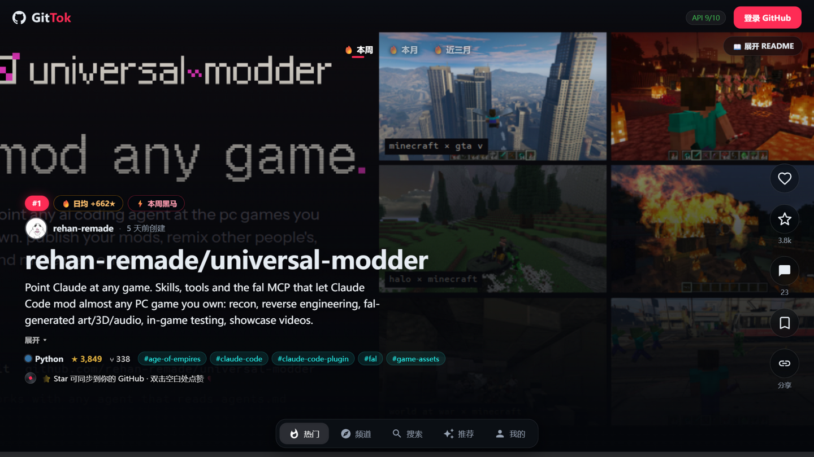
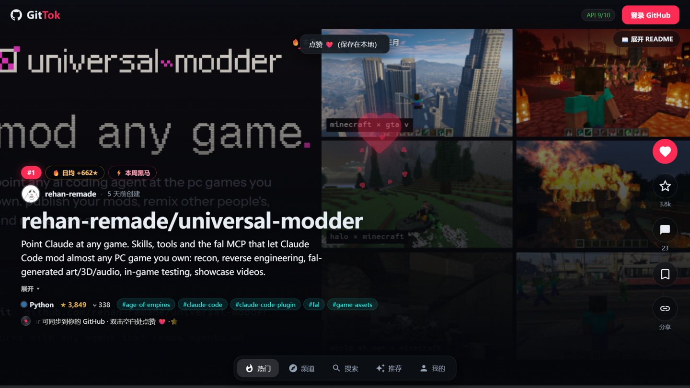
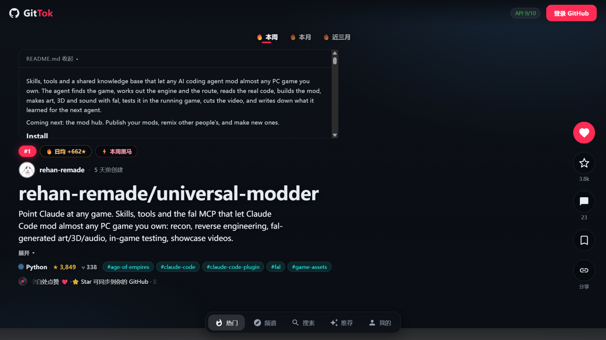
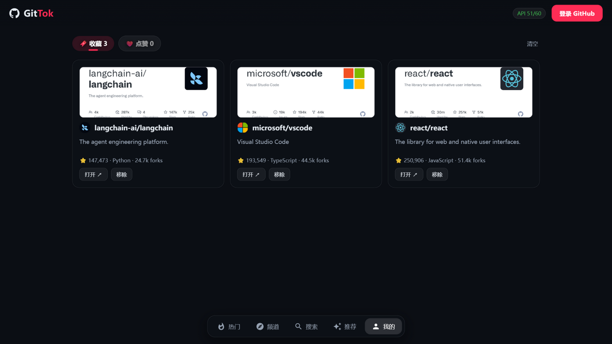

# 🐙 GitTok

**像刷 TikTok 一样刷 GitHub。**

全屏竖向信息流，上下滑动逐个浏览 GitHub 仓库：项目主图自动铺满、README 免跳转展开、双击点赞爱心爆发、话题与作者站内闭环，登录后还能把 Star 真实同步到你的 GitHub 账号。纯前端、无后端、无追踪。

  



## ✨ 特性

- **🖥 全屏沉浸流** —— 一屏一仓库，逐卡吸附翻页（滚轮 / ↑↓ / J K / 触摸滑动）。快滑到底自动加载下一页，相邻卡的 README 与主图/视频提前预载，滑过去即秒出。
- **🎞 内容会动** —— 优先播放 README 里的 demo 视频（静音自动循环，右上角一键开声 🔊），其次项目主图铺满全屏，纯文字仓库回落到"一句话引言"排版。换图先预载、再交叉淡入，观看中画面不会被突然换掉。
- **🔗 站内闭环** —— 点卡片上的 `#话题` 直接切入该话题的频道流，点作者头像切入该作者的仓库流，像 TikTok 点 hashtag / 头像一样接着刷，不用跳出。
- **❤️ 双击点赞** —— 双击卡片任意空白处：SVG 爱心回弹爆发 + 四散小心 + 触觉震动，点赞/收藏保存在本地，刷新不丢。
- **📖 README 即看** —— 卡片上直接展开完整 README，面板内滚轮/空格正常滚动，滚到头才继续翻页，Esc 收起，全程不用跳 GitHub。
- **💬 讨论即评论** —— 不另建评论系统，讨论区直接复用仓库的 GitHub Issues：看最热/最新的 issue、内联展开正文与评论，深度互动一键跳转原帖。
- **⭐ Star 同步** —— 登录 GitHub 后，右栏一键 Star / 取消 Star，真实同步到你的账号。
- **📌 接着刷** —— 浏览位置、频道选择、搜索词、时间窗全部存本地：刷新页面或改天再来，自动回到上次刷到的那张卡。

## 🎬 界面速览

| 双击点赞 | 站内闭环 |
| --- | --- |
|  |  |
| **双击空白处**：爱心爆发、右栏点亮、本地保存 | **点头像 / #话题**：直接刷作者的仓库流、话题频道流 |

| README 即看 | 我的收藏 |
| --- | --- |
|  |  |
| **免跳转**：Markdown 渲染、面板内正常滚动 | **本地存档**：收藏与点赞完整快照，离线可看 |

## 🎮 交互速查

| 操作 | 效果 |
| --- | --- |
| 滚轮 / ↑↓ / J K / PgUp PgDn / 触摸滑动 | 逐卡翻页 |
| 双击卡片空白处 / `L` | 点赞（爱心爆发） |
| `C` · `S` · `F` | 打开讨论 · Star 到 GitHub · 收藏 |
| `Esc` | 收起 README / 关闭讨论抽屉 |
| `Home` | 回到流的开头 |
| 点 `#话题` · 点作者头像 | 站内切入话题 / 作者频道流 |

> 每张卡的"唱片跑马灯"会轮播两条操作提示，刷着刷着就都会了。

## 📺 频道

| 频道 | 说明 |
| --- | --- |
| 🔥 热门 | 近期创建的高星仓库（近似 GitHub Trending，支持 本周 / 本月 / 近三月 时间窗） |
| 🧭 频道 | 按语言（20 种预设 + 自定义主题）刷对应领域的仓库，也可从卡片上的话题/作者一路刷进去 |
| 🔍 搜索 | 关键词搜索，结果进入同样的滑动浏览模式 |
| ✨ 推荐 | 登录后根据你 Star 过的仓库统计高频语言/主题，推荐同类宝藏项目，支持"换一批" |
| 🔖 我的 | 本地点赞与收藏列表（保存完整快照，刷新不丢） |

## 🚀 快速开始

```bash
npm install
npm run dev        # 打开 http://localhost:5173
```

**不登录也能刷**：直接浏览热门 / 频道 / 搜索，点赞收藏保存在浏览器本地。
未登录时 GitHub API 限额 60 次/小时（搜索 10 次/分钟），登录后提升到 5000 次/小时。

### 登录 GitHub（可选，解锁同步 Star + 个性化推荐）

GitTok 使用 **GitHub OAuth 设备码登录**（无需后端、无需 client secret、无固定回调地址）：

1. 打开 [GitHub OAuth App 创建页](https://github.com/settings/applications/new)，应用名随意，Homepage URL 填 `http://localhost:5173`，回调 URL 可不填
2. 创建后进入应用设置，勾选 **Enable Device Flow**
3. 复制 Client ID：
   ```bash
   cp .env.example .env
   # 编辑 .env，填入 VITE_GITHUB_CLIENT_ID=你的client_id
   ```
4. 重启 `npm run dev`，点击右上角「登录 GitHub」→ 输入设备码完成授权

设备码流程需要访问 `github.com`；如果你的网络访问 github.com 不稳定，可以改用 **Personal Access Token 登录**（只依赖 `api.github.com`，勾选 `public_repo` 权限即可，登录弹窗里有直达创建链接），或者把 `VITE_GH_AUTH_BASE` 指向你自建的代理。

## 生产部署说明

构建产物是纯静态文件（`npm run build` → `dist/`），但设备码登录需要一个小代理转发请求到 GitHub（浏览器直连 github.com 的 OAuth 端点会被 CORS 拦截）。开发环境由 Vite 代理（`vite.config.ts` 中的 `/gh-auth`）承担；生产环境部署一个几行的 Cloudflare Worker 即可：

```js
export default {
  async fetch(req) {
    const url = new URL(req.url)
    if (url.pathname.startsWith('/gh-auth/')) {
      return fetch('https://github.com' + url.pathname.slice('/gh-auth'.length), req)
    }
    return new Response('not found', { status: 404 })
  },
}
```

然后给前端设置环境变量 `VITE_GH_AUTH_BASE=https://你的worker域名/gh-auth` 重新构建。仓库数据（api.github.com）始终由浏览器直连，不经过代理。

## 项目结构

```
src/
├─ api/            # GitHub REST 封装：限流处理、搜索/Star 缓存、Issues 复用
├─ auth/           # 登录态 Context + 设备码登录轮询
├─ feeds/          # 内容流：trending / language / topic / author / search / recommend
├─ hooks/          # useFeed（分页预取）、useSnapScroll（滚轮/键盘翻页 + README 面板滚动接管）
├─ components/     # FeedViewer、RepoCard、CardMedia、ActionBar、CommentsDrawer、各面板
├─ utils/          # 媒体提取与预载、本地方案存储、toast、触感反馈、格式化
└─ styles/         # 暗色主题全局样式
```

## 实现说明

- **数据源**：GitHub 没有官方 Trending API，热门流用 `created:>近N天 stars:>10` 按 star 排序近似；推荐流拉取用户最近 200 个 Star 统计语言/主题后定向搜索并去重；作者流/话题流直接走仓库搜索（`user:` / `topic:`）
- **媒体策略**：README 主图/视频从原文提取并解析到 raw 直链；卡片优先播放 demo 视频（静音自动循环），相邻卡的 README、主图与视频首块（Range 请求）都会提前预载，换图先预载再交叉淡入
- **API 策略**：README 优先走 `raw.githubusercontent.com` 直链（零 API 额度消耗，未登录也能刷得更久），拿不到才回退 API；Star 状态、搜索结果、Issues 均有会话级缓存；页脚徽标实时展示剩余额度
- **隐私**：Token、点赞、收藏、浏览位置全部只存浏览器 localStorage，没有任何服务器
